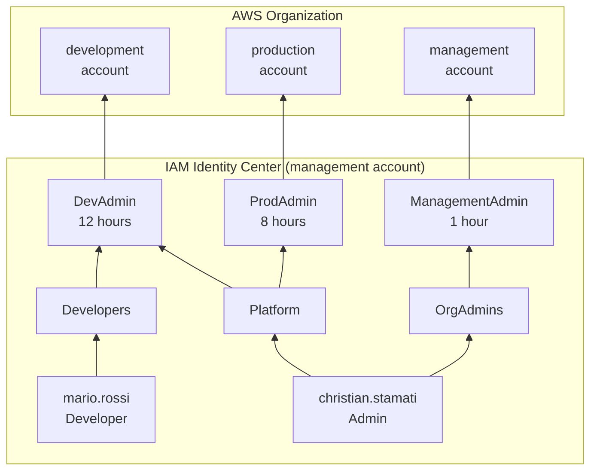
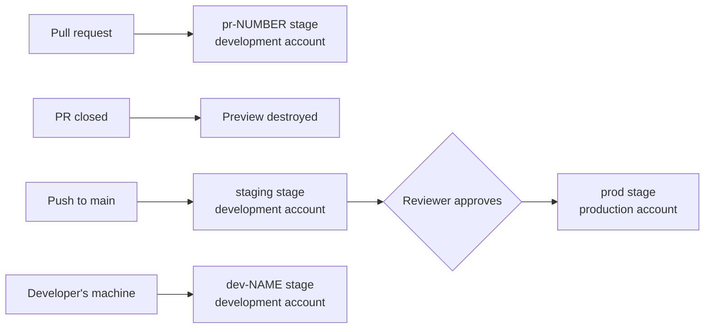

# Overview

A reference setup for deploying a TypeScript app to AWS with [Alchemy](https://alchemy.run), using one AWS Organization, separate dev and prod accounts, SSO for people, and short-lived OIDC credentials for GitHub Actions.

No long-lived AWS keys are used. Root is reserved for emergencies.

## Hierarchy

Read the access path from the bottom up: a user joins a group, and a group gets a permission set on an account.



## Deployment flow



## Accounts and stages

| Account | Purpose | Workloads | Stages |
| --- | --- | --- | --- |
| Management | Organization, SSO, billing | None | None |
| Development | Building and testing | Yes | `dev-<name>`, `test-<name>`, `pr-<number>`, `staging` |
| Production | Live application | Yes | `prod` |

## Who deploys what

| Stage | Deployed by | Credentials | Removed by |
| --- | --- | --- | --- |
| `local-<name>` | `bun alchemy dev`, in a local emulator | SSO, for state only | `bun alchemy destroy --stage local-<name>` |
| `dev-<name>` | Developer | SSO | `bun alchemy destroy` |
| `test-<name>` | `bun test` | SSO | `bun alchemy destroy --stage test-<name>` |
| `pr-<number>` | GitHub Actions | OIDC role | Closing the PR |
| `staging` | GitHub Actions, on push to `main` | OIDC role | Manual |
| `prod` | GitHub Actions, after approval | Production OIDC role | Manual |

## Monorepo structure

This repo is currently a single package. As the project grows, use Bun workspaces and keep infrastructure separate from application code:

```text
.
├── apps/
│   ├── api/
│   │   ├── src/
│   │   │   └── api.ts           # Lambda and its resources
│   │   ├── test/
│   │   │   └── integ.test.ts    # Integration tests against a real stage
│   │   └── package.json
│   └── web/                     # Frontend, if any
│       └── package.json
├── packages/
│   └── shared/                  # Shared types and utilities
│       └── package.json
├── stacks/
│   ├── github.ts                # Dev OIDC role and repo variables
│   └── github-prod.ts           # Prod OIDC role and approval environment
├── docs/
├── .github/
│   └── workflows/
│       └── deploy.yml           # Previews, staging, prod
├── alchemy.run.ts               # App stack entrypoint
├── .env.example                 # Per-developer stage names
├── package.json                 # Workspace root: "workspaces": ["apps/*", "packages/*"]
└── tsconfig.json
```

| Now | In a monorepo |
| --- | --- |
| `src/api.ts` | `apps/api/src/api.ts` |
| `test/integ.test.ts` | `apps/api/test/integ.test.ts` |

This layout is a recommendation and has not been built or tested yet. Apps don't each need an `alchemy.run.ts`, because the root file can deploy them all. See [Monorepo](09-monorepo.md).

## Guides

Follow these in order for a new setup:

1. [AWS Organization](01-aws-organization.md)
2. [IAM Identity Center](02-identity-center.md)
3. [Local setup](03-local-setup.md)
4. [Alchemy stack](04-alchemy-stack.md)
5. [Testing](05-testing.md)
6. [CI/CD](06-ci-cd.md)
7. [Onboarding a developer](07-onboarding.md)
8. [Troubleshooting](08-troubleshooting.md)
9. [Monorepo](09-monorepo.md)

## Known gaps

- **CI is currently turned off.** The workflow, OIDC roles, repo variables and `production` environment are removed, and no app stages are deployed. The diagrams and guides show the full setup. See [CI/CD](06-ci-cd.md) to restore it.
- **The API has no authentication.** Anyone with a function URL can read and write that stage's bucket, and this public repo's Actions logs contain those URLs. Do not store real data until this is fixed.
- **The CI roles use `AdministratorAccess`.** Replace them with narrower policies.
- **`prod` has no deletion guard beyond `forceDestroy: false`.** Consider `RemovalPolicy.retain()` for production data.
- **No organization-wide CloudTrail or AWS Budget alert yet.**
- **`CI=true` test teardown fails** with a state lock. See [Testing](05-testing.md).
